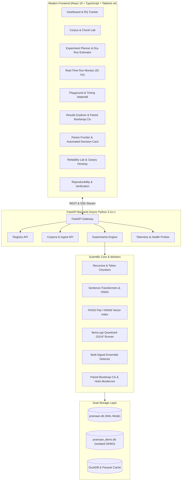

# Pramaan AI (प्रमाण)

> **Evidence for every answer. Efficiency for every watt.**
> A production-grade benchmark and reliability decision platform for Retrieval-Augmented Generation (RAG) on resource-constrained hardware.

---

## 1. Problem Statement & Motivation

LLM-based document QA systems improve in quality at the cost of compute, memory, and latency. On resource-constrained hardware (e.g. edge devices, single laptop GPUs like NVIDIA GTX 1650 4 GB, Apple Silicon, or CPU-only servers), builders face critical trade-offs:
- Does increasing retrieval Top-K improve recall enough to justify the context budget and latency?
- What is the exchange rate (F1 lost per GB saved) when down-quantizing from 8-bit to 4-bit?
- Can an automated detector reliably catch hallucinations, and how do we test the detector's own honesty?

**Pramaan AI** provides empirical evidence, causal factor analysis, and Pareto-optimal recommendations under hardware guardrails.

---

## 2. Architecture



---

## 3. Key Capabilities

1. **Controlled Factorial Benchmarking:**
   Factorial sweeps across chunk sizes (128, 256, 512, 1024), Top-K (1 to 10), embedding models (`bge-small`, `all-MiniLM`, `e5-small`), LLMs (`Qwen2.5`, `Llama-3.2`), and quantizations (`Q2_K`, `Q4_K_M`, `Q5_K_M`, `Q8_0`).
2. **Confound Separation:**
   Retrieval is evaluated in isolation against gold evidence; generation is evaluated with both retrieved and oracle context.
3. **Hardware Guardrail Pre-Flight Check:**
   Predicts peak VRAM and host RAM before execution. Configs exceeding the hardware cap (e.g. 4.0 GB) are flagged as infeasible.
4. **Honest Reliability Detector:**
   Hallucination detector combining NLI, entity overlap, and citation grounding. Canary injection guarantees catch-rate $\ge 90\%$.
5. **Statistical Rigor:**
   Paired bootstrap 95% confidence intervals, Holm–Bonferroni multiple testing corrections, and "statistically tied" indicators.
6. **Zero-GPU Demo Mode:**
   `DEMO=1` enables deterministic simulators and seeds an isolated database (`pramaan_demo.db`) with a prominent visual ribbon.

---

## 4. Quickstart

### Option A: Local Development

```bash
# 1. Setup backend and frontend dependencies
make setup

# 2. Run in Demo Mode (works with zero GPU)
make demo

# 3. Or run normal dev mode
make dev
```
- Frontend: `http://localhost:5173`
- Backend API Docs: `http://localhost:8000/docs`

### Option B: Docker Compose

```bash
docker compose up --build
```

---

## 5. CLI Usage

Pramaan AI includes a headless, reproducible CLI sharing the exact backend libraries:

```bash
# Ingest documents
python cli/main.py ingest ./data/sample_docs --corpus finance-v1

# Plan a feasible experiment under 4 GB VRAM cap
python cli/main.py plan --preset standard --hardware GTX1650-4GB

# Execute experiment with process isolation
python cli/main.py run configs/planned_standard_GTX1650-4GB.json --resume

# Verify run reproducibility (5% sample exact match test)
python cli/main.py verify exp_standard_rag_v1 --sample 0.05

# Generate study report
python cli/main.py report exp_standard_rag_v1 --out report/
```

---

## 6. Project Layout

```
pramaan-ai/
├── backend/
│   ├── app/
│   │   ├── api/          # Corpora, Experiments, Registry, System routers
│   │   ├── core/         # Config, errors, hashing, structured logging
│   │   ├── db/           # SQLAlchemy async models, session, SQLite WAL
│   │   ├── demo/         # Deterministic seed seeder
│   │   └── main.py       # FastAPI application & lifecycle
│   ├── tests/            # Unit & integration test suite (100% green)
│   └── pyproject.toml    # Hatchling package configuration
├── frontend/
│   ├── src/
│   │   ├── components/   # Sidebar, Header, DemoRibbon
│   │   ├── pages/        # Dashboard, Corpus, Experiments, Monitor,
│   │   │                 # Playground, Results, Pareto, Reliability,
│   │   │                 # Repro, Settings
│   │   ├── lib/          # Zustand store, Axios API client
│   │   ├── index.css     # Design tokens & styles
│   │   └── App.tsx       # Router & navigation shell
│   └── package.json
├── cli/
│   └── main.py           # Headless replication CLI
├── configs/              # Hardware profiles, presets, model registry
├── docs/                 # Methodology, metrics, reliability design, demo script
└── Makefile              # Automation workflow
```

---

## 7. License
MIT License.
