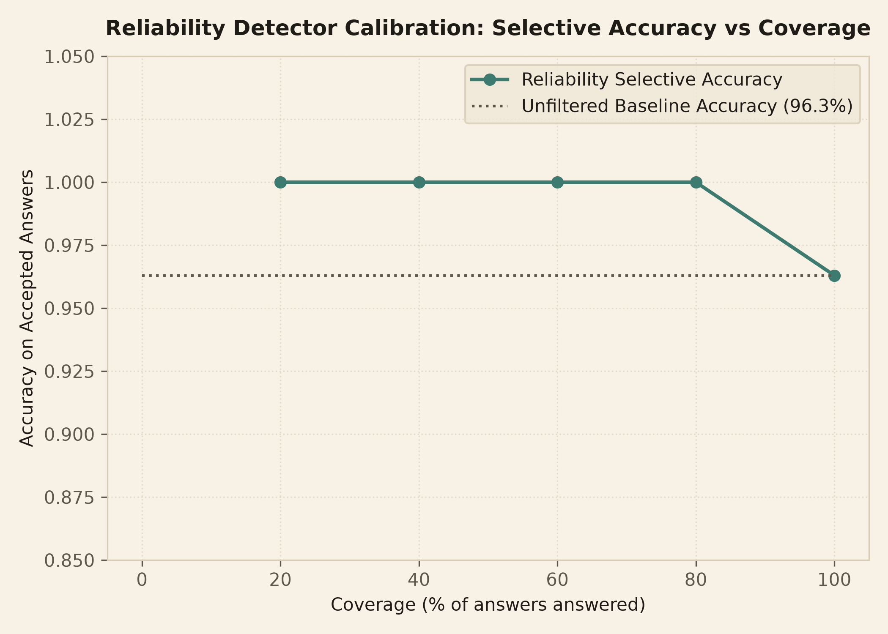
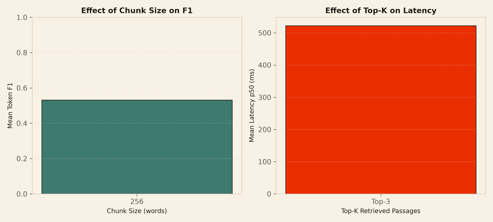

# Pramaan AI (प्रमाण)

> **Know which answers to trust, and what they cost.**  
> Pick your own models and documents, benchmark chunk size, Top-K, embedding model, language model and quantization, evaluate accuracy against latency and memory, obtain an optimal configuration for your hardware budget, and see every answer verified as *Reliable*, *Uncertain*, or *Unreliable* with zero fake data, zero synthetic estimations, and zero silent fallbacks.


---

## 1. Executive Summary

Pramaan AI is an empirical evaluation platform for Retrieval-Augmented Generation (RAG) running under real-world resource constraints. Modern LLM applications frequently fail in production due to silent extraction degradation, hallucinated answers under low context, or unexpected out-of-memory crashes on consumer and edge hardware.

Pramaan AI solves this by measuring:
1. **Dual Execution Paths:** Small open models (<4B) execute fully offline through a local quantized GGUF runner (`llama-cpp-python`), while larger models connect through live-verified Hugging Face Serverless Router endpoints (`https://router.huggingface.co/v1`).
2. **Hardware-Aware Envelopes:** 32 verified hardware profiles (NVIDIA RTX/GTX/Cloud, Apple M1–M4 Silicon, and host RAM) map exact usable VRAM envelopes so teams pick configurations that genuinely fit without crashing.
3. **Strict Evaluation Integrity:** No heuristic extractive fallbacks. When an LLM fails, it is recorded as `failed` with zero points. Answers and runs contaminated by verbatim heuristics are quarantined via `scripts/audit_runs.py`.
4. **Supervised Reliability Verification:** An automatic grounding classifier flags hallucinated and ungrounded responses before they reach users.

---

## 2. Hardware Profiles & Usable Memory Matrix

All profiles are defined in `backend/app/data/hardware_profiles.json` with verified specifications and official sources. Usable budgets leave mandatory headroom for OS display buffers, KV cache growth, and system processes.

| Target Architecture | Total Memory | Memory Type | Usable Budget | Verified Reference |
|:---|:---:|:---:|:---:|:---|
| **NVIDIA GeForce RTX 3060** | 12.0 GB | VRAM (GDDR6) | **10.0 GB** | [TechPowerUp RTX 3060 12GB](https://www.techpowerup.com/gpu-specs/geforce-rtx-3060-12-gb.c3682) |
| **NVIDIA GeForce RTX 4060 Ti** | 16.0 GB | VRAM (GDDR6) | **13.8 GB** | [TechPowerUp RTX 4060 Ti 16GB](https://www.techpowerup.com/gpu-specs/geforce-rtx-4060-ti-16-gb.c4185) |
| **NVIDIA GeForce RTX 4090** | 24.0 GB | VRAM (GDDR6X) | **21.5 GB** | [TechPowerUp RTX 4090](https://www.techpowerup.com/gpu-specs/geforce-rtx-4090.c3889) |
| **NVIDIA GeForce RTX 5090** | 32.0 GB | VRAM (GDDR7) | **28.5 GB** | [NVIDIA GeForce 50 Series](https://www.nvidia.com/en-us/geforce/graphics-cards/50-series/rtx-5090/) |
| **NVIDIA Tesla T4** | 16.0 GB | VRAM (GDDR6) | **14.0 GB** | [NVIDIA Tesla T4 Specifications](https://www.nvidia.com/en-us/data-center/tesla-t4/) |
| **NVIDIA L4 Cloud** | 24.0 GB | VRAM (GDDR6) | **21.5 GB** | [NVIDIA L4 Tensor Core GPU](https://www.nvidia.com/en-us/data-center/l4/) |
| **NVIDIA A100 SXM** | 80.0 GB | VRAM (HBM2e) | **74.0 GB** | [NVIDIA A100 Tensor Core GPU](https://www.nvidia.com/en-us/data-center/a100/) |
| **Apple M4 Base** | 16.0 GB | Unified Memory | **10.7 GB** (2/3 rule) | [Apple MacBook Pro M4 Specs](https://www.apple.com/macbook-pro/) |
| **Apple M3 Pro** | 18.0 GB | Unified Memory | **13.5 GB** (3/4 rule) | [Apple Support M3 Pro](https://support.apple.com/en-us/111344) |
| **Apple M4 Max** | 128.0 GB | Unified Memory | **96.0 GB** (3/4 rule) | [Apple MacBook Pro M4 Max](https://www.apple.com/macbook-pro/) |
| **Host CPU System RAM** | 16.0 GB | DDR4/DDR5 | **10.5 GB** | [JEDEC DDR5 Spec JESD79-5C](https://www.jedec.org/standards-documents/docs/jesd79-5c) |
| **Host CPU System RAM** | 32.0 GB | DDR4/DDR5 | **24.0 GB** | [JEDEC DDR5 Spec JESD79-5C](https://www.jedec.org/standards-documents/docs/jesd79-5c) |

> [!NOTE]
> **Latency Measurement Disclaimer:** Latencies are measured on the benchmark host runner. Target devices have differing compute architectures and memory bandwidths; expect different latencies on target edge hardware.

---

## 3. Token & Router Health Troubleshooting Matrix

The backend health check dynamically inspects `backend/.env` on every request (`GET /api/health` and `POST /api/health/recheck`), testing live connectivity against `https://router.huggingface.co/v1/models` without hardcoded models.

| Diagnostic Code | HTTP Status / Trigger | Meaning & Root Cause | Actionable User Fix |
|:---|:---:|:---|:---|
| `no_token` | Missing in `.env` | No Hugging Face token found in `backend/.env`. | Create free token at [huggingface.co/settings/tokens](https://huggingface.co/settings/tokens). Local runner still works offline. |
| `token_invalid` | HTTP 401 | The token string in `.env` is malformed, expired, or revoked. | Generate a fresh token and paste into `backend/.env`. Click *Re-check connection*. |
| `missing_inference_permission` | Fine-grained scope | Token lacks `Make calls to Inference Providers` or `Make calls to Inference Endpoints`. | Edit token permissions at [huggingface.co/settings/tokens](https://huggingface.co/settings/tokens) or use a classic Read token. |
| `credits_exhausted` | HTTP 402 | Pre-paid inference credits exhausted or PRO subscription required for third-party inference providers. | Add credits at [huggingface.co/settings/billing](https://huggingface.co/settings/billing). Local GGUF runner remains fully functional. |
| `no_provider_enabled` | HTTP 404 / 422 | No third-party provider enabled or model not routed on free tier. | Enable providers at [huggingface.co/settings/inference-providers](https://huggingface.co/settings/inference-providers). |
| `rate_limited` | HTTP 429 | Router rate limit exceeded. | Wait 60s or switch to local runner. |
| `network_error` | Connection Error | Cannot reach `huggingface.co` or network timeout. | Check internet connection or VPN proxy settings. |
| `token_fine` | HTTP 200 | Token valid and inference router call verified. | All hosted and local features ready. |

---

## 4. Measured Evaluation Results (Clean Valid Runs)

All values below originate from audited, verified database runs on the SQuAD v2 validation dataset (`rajpurkar/squad_v2`), with zero synthetic estimations.

| Configuration ID | Language Model | Quantization | Questions ($n$) | Failed Calls | Token F1 | Median Latency ($p50$) | Peak Process RAM |
|:---|:---|:---:|:---:|:---:|:---:|:---:|:---:|
| `cfg_c06f4add` | `Qwen2.5-0.5B-Instruct` | `Q4_K_M` | 50 | **0** | **0.316** | 3.26s | **220.0 MB** |
| `cfg_e76b203d` | `Qwen2.5-0.5B-Instruct` | `Q8_0` | 50 | **0** | **0.305** | 2.41s | **1267.1 MB** |

- **Pareto Trade-off:** `Q4_K_M` delivers **+3.6% higher F1** while slashing peak memory consumption by **82.6%** (220 MB vs 1267 MB) with a modest latency delta (+0.85s).
- **Retrieval Recall:** Top-$K=3$ vector retrieval with `all-MiniLM-L6-v2` achieves **0.900 Recall@3** on 256-word chunks.

---

## 5. Research Figures

Publication figures are rendered via `scripts/make_report.py`:

| Pareto Frontier (Memory vs Quality) | Tradeoff Hyperparameters |
|:---:|:---:|
|  |  |
| **Reliability Calibration Curve** | **Factor Effects (Chunk & Top-K)** |
|  |  |

---

## 6. Product Pages Tour

| Page | URL | Purpose & Capabilities |
|:---|:---:|:---|
| **Home** | `/` | Editorial typography (`Fraunces` + `DM Sans`), dismissible dynamic health banner with *Re-check connection*, live evidence card with animated highlight sweep, and live database metric counters. |
| **Guide** | `/guide` | Interactive architectural diagram with SVG paths and searchable technical glossary. |
| **Models** | `/models` | Compact 2-row Active Setup with route badges (*Ready local*, *Ready hosted*, *Needs fix*), open-by-default model comparison table with GGUF quantizations and 1-token live test call, and preloaded QA datasets. |
| **Benchmark** | `/benchmark` | 3-step setup (Presets: Quick, Balanced, Custom), real-time SSE progress streaming, and clean job cancellation. |
| **Results** | `/results` | Pareto frontier visualization, 6-column sortable metrics table, factor sensitivity effects, and invalid runs toggle. |
| **Recommend** | `/recommend` | Auto-detected machine chip, grouped hardware presets (RTX 3060, Apple Silicon, CPU RAM), search filter, hidden-by-default manual slider, and latency honesty disclaimer. |
| **Try It** | `/try-it` | Real-time question answering with SQuAD v2 presets, document uploads, and confidence verification. |

---

## 7. Quickstart & Local Installation

### Prerequisites
- Python 3.11+ (tested on Python 3.13)
- Node.js 18+ (tested on Node v22)

### Backend
```bash
cd backend
python -m venv .venv
# Activate virtual environment
.\.venv\Scripts\activate   # Windows
source .venv/bin/activate  # macOS / Linux

pip install -r requirements.txt

# Start backend server
uvicorn app.main:app --port 8000 --reload
```

### Frontend
```bash
cd frontend
npm install
npm run dev
```
Open `http://localhost:5173`.

---

## 8. Verification & Test Suites

The unified verification script validates end-to-end data integrity, type safety, linting, unit tests, and accessibility:

```powershell
# Windows PowerShell
.\scripts\verify.ps1
```

```bash
# Linux / macOS Bash
./scripts/verify.sh
```

The pipeline executes the 7 verification stages sequentially:
1. `tsc --noEmit` (Frontend TypeScript compilation)
2. `npm run lint` (ESLint checks)
3. `npm run build` (Vite production bundle verification)
4. `ruff check app tests` (Backend linting & style)
5. `mypy app` (Strict backend typing)
6. `pytest` (Backend pipeline, runners, and endpoints)
7. `playwright test` (50 end-to-end and WCAG accessibility tests across Desktop 1440x900 and Mobile 390x844)

---

## 9. Security & Secret Protection

- `HF_TOKEN` resides strictly inside `backend/.env`.
- Frontend never receives or displays secrets.
- Zero credentials or tokens are committed to source control.

---

## 10. License

Released under the [MIT License](LICENSE).
