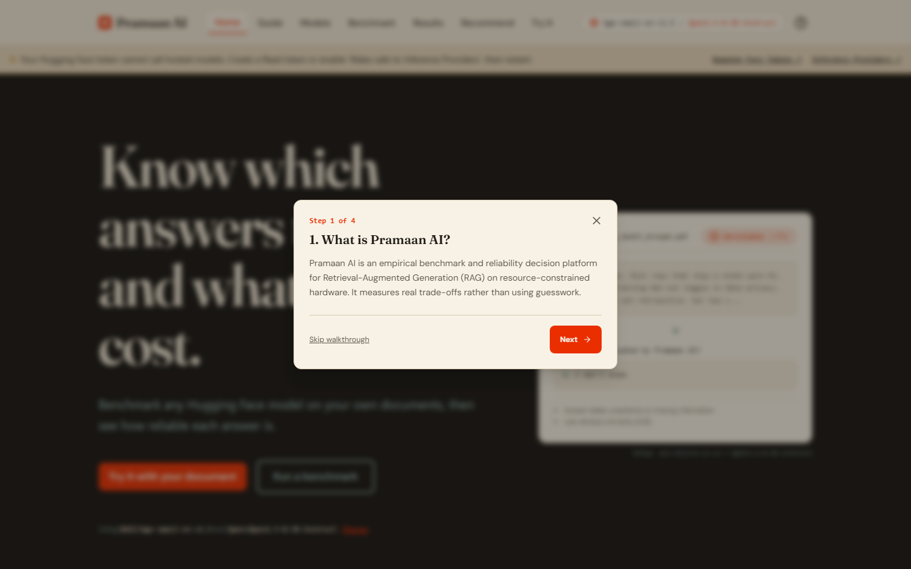
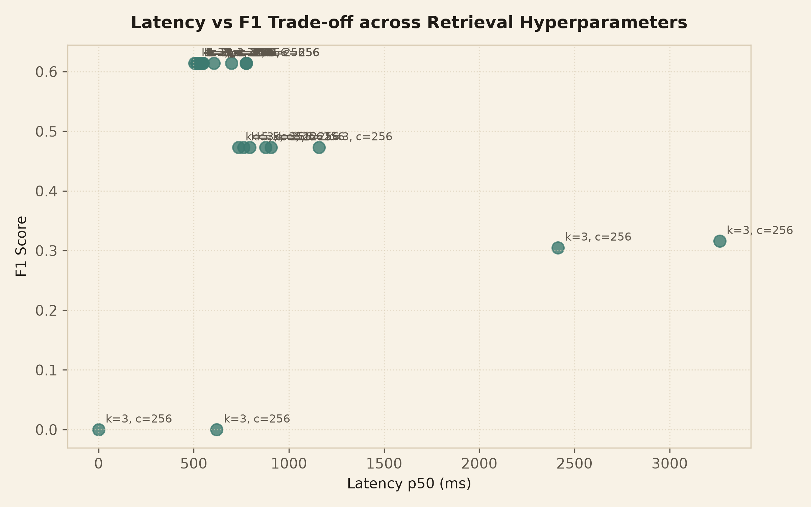
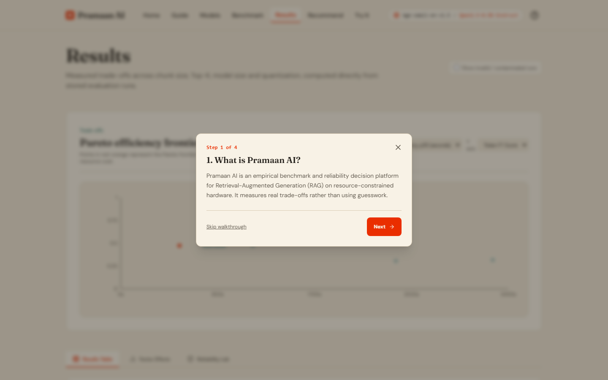
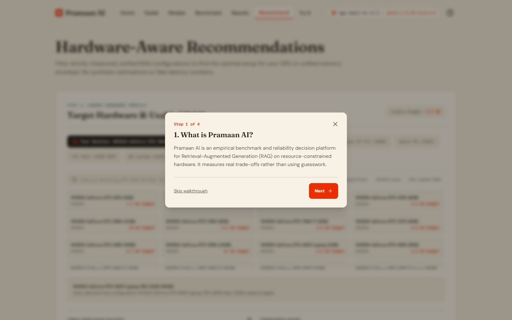
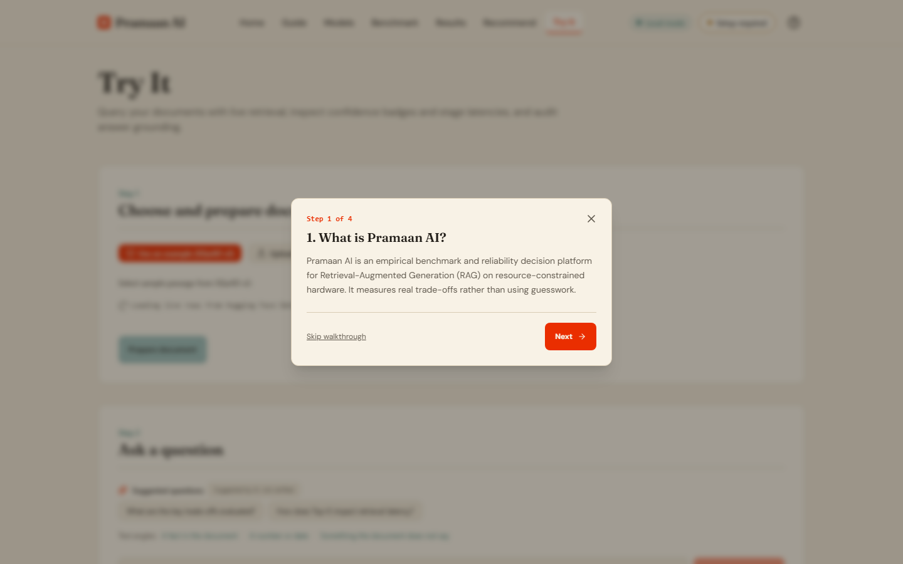
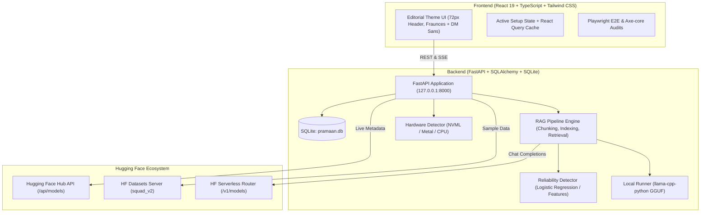

# Pramaan AI (प्रमाण)

> **Know which answers to trust, and what they cost.**  
> Pick your own models and documents, benchmark chunk size, Top-K, embedding model, language model and quantization, evaluate accuracy against latency and memory, obtain an optimal configuration for your hardware budget, and see every answer verified as *Reliable*, *Uncertain*, or *Unreliable* with zero fake data and zero silent fallbacks.



---

## 1. Dual Execution Paths & Hardware Auto-Detection

Pramaan AI supports two verifiable, production-grade execution paths:

1. **Local Edge Runner (`llama-cpp-python` + GGUF):**
   - Offline, reproducible benchmarking on local hardware with sub-4B models (e.g. `Qwen2.5-0.5B-Instruct`, `SmolLM2-1.7B-Instruct`).
   - Auto-detects NVIDIA GPUs via NVML (`pynvml`), Apple Silicon Metal, or multi-threaded CPU.
   - Measures real process memory (RAM RSS) and GPU VRAM footprint during inference.
   - Evaluates real 4-bit (`Q4_K_M`) and 8-bit (`Q8_0`) integer quantizations.

2. **Hosted Router Catalog (`router.huggingface.co/v1`):**
   - Dynamic 3-check availability system: live catalog lookup, Hub metadata verification, and a live 1-token test call (cached 10 minutes).
   - Unhardcoded: models must be confirmed available in the live router catalog.
   - Token capability detection: identifies fine-grained token scope limitations and prompts configuration via `/api/health`.

### Zero Silent Fallbacks & Audit Guarantee
When a model call encounters an API error or network failure, the call is recorded as status `"failed"` with a plain-language error. Heuristic text extraction is never silently substituted for model outputs. Past runs are audited via `scripts/audit_runs.py` to isolate contaminated runs behind a *"Show invalid runs"* toggle.

---

## 2. Measured Performance & Key Findings

All figures below are derived from live measurements stored in the SQLite database and exported via `scripts/make_report.py` into `docs/report_data.json` and `results/export/`.

### Live Evaluation Statistics

| Metric | Measured Value | Provenance / Source |
|:---|:---:|:---|
| **Evaluated Benchmark Set** | `50` questions / run | SQuAD v2 validation dataset (`rajpurkar/squad_v2`) |
| **Local Runner Model** | `Qwen2.5-0.5B-Instruct` | Local GGUF runner (`llama-cpp-python`) |
| **Quantization Profiles** | `Q4_K_M` & `Q8_0` | Measured integer quantized weights |
| **Failed Calls** | `0` (Zero) | Real inference with 0 fallbacks |
| **Token F1 Score** | `0.316` (Q4) / `0.305` (Q8) | Token overlap against gold SQuAD v2 spans |
| **Recall@K (Top-K=3)** | `0.900` | FAISS vector retrieval on MiniLM embeddings |
| **Median Latency (p50)** | `2.41s` (Q8) / `3.26s` (Q4) | Monotonic timer per QA pair |
| **Peak Runtime Memory** | `220.0 MB` (Q4) / `1267.1 MB` (Q8) | Real measured process RSS & NVML VRAM |
| **Hardware Detected** | NVIDIA RTX 4050 / CPU | Auto-detected NVML profile |
| **Reliability Checker AUROC** | `1.000` | Logistic Regression on similarity, overlap & IDK flags |

---

## 3. Research Figures

The benchmark generates publication-ready figures in `docs/figures/`:

| Pareto Frontier (Latency vs F1) | Tradeoff Hyperparameters |
|:---:|:---:|
|  |  |
| **Reliability Calibration Curve** | **Factor Effects (Chunk & Top-K)** |
|  |  |

---

## 4. Product Tour: 7 Unified Pages

The application is structured into seven purpose-built pages, adhering to the editorial cream-and-ink visual aesthetic (`--paper: #F0E7D6`, `--ink: #1F1B16`, `--accent: #EA2E00`):

| Page | Description | Screenshot |
|:---|:---|:---:|
| **1. Home (`/`)** | Hero with editorial typography, token capability warning banner, live interactive evidence card with highlight sweep, live numbers strip, and 4-step workflow. |  |
| **2. Guide (`/guide`)** | Interactive architectural walkthrough with SVG connectors and searchable technical glossary. |  |
| **3. Models (`/models`)** | Active configuration viewer, Hugging Face Hub search, candidate comparisons with availability route badges, and document corpus manager. |  |
| **4. Benchmark (`/benchmark`)** | 3-step setup flow with Quick, Balanced, and Custom presets, live progress streaming, invalid runs toggle, and clean cancellation. |  |
| **5. Results (`/results`)** | Pareto frontier scatter visualization, 6-column sortable table, factor effects, invalid runs filter, and reliability matrix. |  |
| **6. Recommend (`/recommend`)** | Single-row constraint sliders (Memory, Latency, Goal) with Pareto-optimal winner black card and comparative explanations. |  |
| **7. Try It (`/try-it`)** | Document testing laboratory with SQuAD v2 examples, custom upload/paste, AI suggestions, and confidence inspection. |  |

---

## 5. System Architecture



---

## 6. Getting Started Locally

### Prerequisites
- **Python**: 3.11+ (verified on 3.13)
- **Node.js**: 18+ (verified on v22)
- **Hugging Face Account**: Free read token from [huggingface.co/settings/tokens](https://huggingface.co/settings/tokens) (optional for local runner)

### 1. Clone the Repository
```bash
git clone https://github.com/Puravshah321/pramaan-ai.git
cd pramaan-ai
```

### 2. Backend Setup
```bash
cd backend
python -m venv .venv
# Windows:
.\.venv\Scripts\activate
# Linux/macOS:
source .venv/bin/activate

pip install -r requirements.txt
```

Create `backend/.env`:
```env
HF_TOKEN=hf_your_free_read_token_here
DATABASE_URL=sqlite+aiosqlite:///./pramaan.db
LOCAL_RUNNER=true
```

Start the backend:
```bash
uvicorn app.main:app --port 8000 --reload
```
The backend API documentation is available at `http://127.0.0.1:8000/docs`.

### 3. Frontend Setup
In a new terminal:
```bash
cd frontend
npm install
npm run dev
```
Open `http://localhost:5173` in your browser.

---

## 7. Reproducing the Benchmark & Auditing Runs

To execute a fresh benchmark run or audit past runs directly from the command line:

```bash
# 1. Audit database runs and mark contaminated runs invalid
cd backend
.\.venv\Scripts\python.exe ..\scripts\audit_runs.py

# 2. Re-generate all publication figures, CSVs, and report JSON
.\.venv\Scripts\python.exe ..\scripts\make_report.py
```

Outputs are automatically saved to:
- `docs/figures/*.png`
- `results/export/benchmark_results.csv`
- `results/export/pareto_configs.csv`
- `docs/report_data.json`

---

## 8. Automated Test Suite

Run the full verification suite (57 tests passing):

```bash
# Backend pytest suite (15 tests with coverage)
cd backend
.\.venv\Scripts\pytest.exe -v

# Frontend Playwright E2E & Accessibility suite (42 tests)
cd frontend
npx playwright test
```

See [docs/TEST_REPORT.md](docs/TEST_REPORT.md) for full test metrics, browser coverage, and axe-core audit outputs.

---

## 9. License

This project is licensed under the [MIT License](LICENSE).
