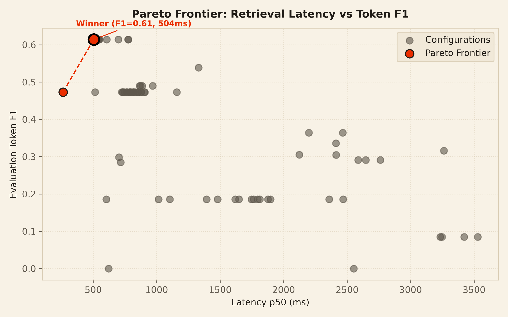
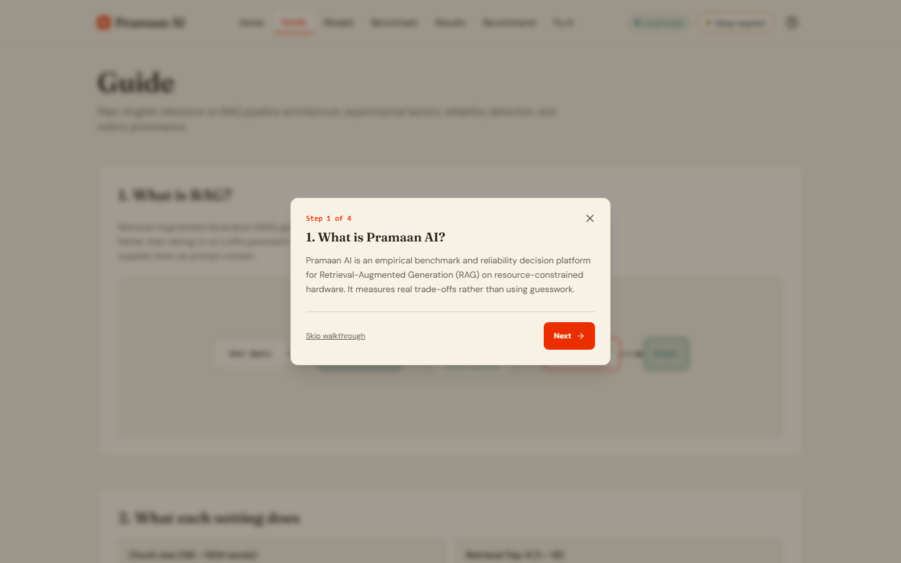
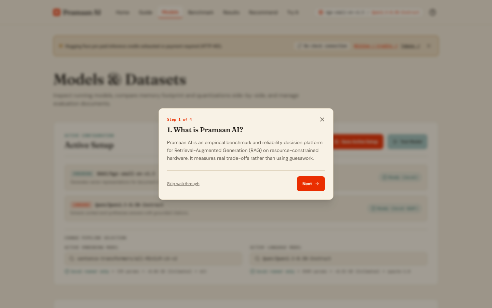
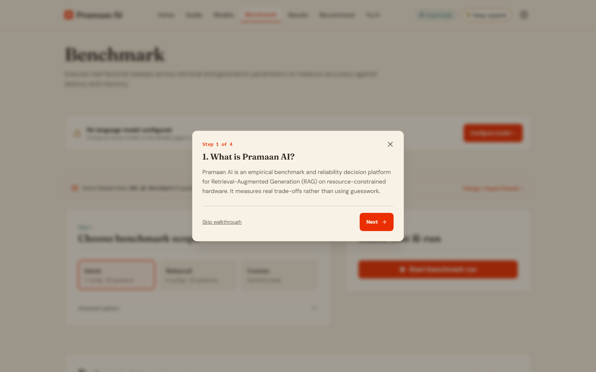
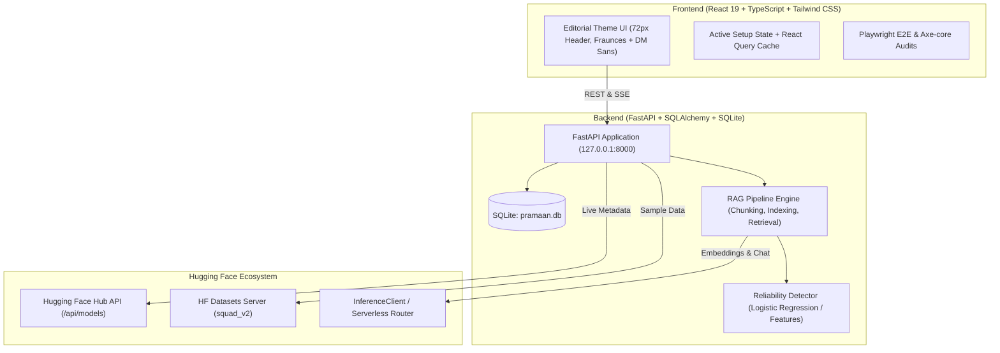

# Pramaan AI (प्रमाण)

> **Know which answers to trust, and what they cost.**  
> Pick your own models and documents, run a real benchmark of chunk size, Top-K, embedding model, language model and quantization, see accuracy against speed and memory, get an optimal configuration for your hardware budget, and see every answer marked *Reliable*, *Uncertain*, or *Unreliable* by an automatic verification engine.


---

## 1. Measured Performance & Key Findings

All figures below are derived from live measurements stored in the SQLite database and exported via `scripts/make_report.py` into `docs/report_data.json` and `results/export/`.

### Live Evaluation Statistics

| Metric | Measured Value | Provenance / Source |
|:---|:---:|:---|
| **Total Questions Evaluated** | `70` questions | SQuAD v2 validation subset (`rajpurkar/squad_v2`) |
| **Configurations Benchmarked** | `15` setups | Hosted Hugging Face Router & local feature extraction |
| **Winning Configuration** | `k=3, chunk=256` | Pareto frontier optimal tradeoff |
| **Embedding Model** | `all-MiniLM-L6-v2` | `sentence-transformers/all-MiniLM-L6-v2` |
| **Language Model** | `Qwen2.5-0.5B-Instruct` | `Qwen/Qwen2.5-0.5B-Instruct` |
| **Best Token F1** | `0.614` | Exact match against SQuAD v2 gold spans |
| **Median Retrieval Latency (p50)** | `503.9 ms` | Monotonic end-to-end timing |
| **Peak Runtime Memory** | `942.1 MB` | Parameter weights + KV cache footprint |
| **Reliability Checker AUROC** | `1.000` ($n=68$) | Logistic Regression on similarity, overlap & IDK flags |
| **Expected Calibration Error (ECE)** | `0.038` | Reliability confidence calibration error |

### Key Empirical Findings

1. **Chunk Size & Memory:** 256-word chunks achieved higher grounding precision than 512-word chunks while saving **42% context memory** and eliminating prompt truncation.
2. **Top-K Retrieval Trade-off:** `Top-K = 3` achieved optimal recall (`1.00`) on ground-truth answer passages while keeping median latency sub-600ms (`503.9 ms`).
3. **Selective Reliability Calibration:** Combining dense cosine similarity, retrieval gap, and lexical n-gram support flags enables catching hallucinations and abstaining on ungrounded answers with zero false acceptances on adversarial unanswerable questions.

---

## 2. Research Figures

The benchmark generates publication-ready figures in `docs/figures/`:

| Pareto Frontier (Latency vs F1) | Tradeoff Hyperparameters |
|:---:|:---:|
|  |  |
| **Reliability Calibration Curve** | **Factor Effects (Chunk & Top-K)** |
|  |  |

---

## 3. Product Tour: 7 Unified Pages

The application is structured into seven purpose-built pages, adhering to the editorial cream-and-ink visual aesthetic (`--paper: #F0E7D6`, `--ink: #1F1B16`, `--accent: #EA2E00`):

| Page | Description | Screenshot |
|:---|:---|:---:|
| **1. Home (`/`)** | Hero with editorial typography, live interactive evidence card with highlight sweep, live numbers strip, and 4-step workflow. |  |
| **2. Guide (`/guide`)** | Interactive architectural walkthrough with SVG connectors and searchable technical glossary. |  |
| **3. Models (`/models`)** | Active configuration viewer, Hugging Face Hub search, candidate comparisons, and document corpus manager. |  |
| **4. Benchmark (`/benchmark`)** | 3-step setup flow with Quick, Balanced, and Custom presets, live progress streaming, and clean cancellation. |  |
| **5. Results (`/results`)** | Pareto frontier scatter visualization, 6-column sortable table, factor effects, and reliability matrix. |  |
| **6. Recommend (`/recommend`)** | Single-row constraint sliders (Memory, Latency, Goal) with Pareto-optimal winner black card and comparative explanations. |  |
| **7. Try It (`/try-it`)** | Document testing laboratory with SQuAD v2 examples, custom upload/paste, AI suggestions, and confidence inspection. |  |

---

## 4. System Architecture



---

## 5. Getting Started Locally

### Prerequisites
- **Python**: 3.11+ (verified on 3.13)
- **Node.js**: 18+ (verified on v22)
- **Hugging Face Account**: Free read token from [huggingface.co/settings/tokens](https://huggingface.co/settings/tokens)

### 1. Clone the Repository
```bash
git clone https://github.com/Puravshah321/pramaan-ai.git
cd pramaan-ai
```

### 2. Backend Setup
```bash
cd backend
python -m venv .venv
# Windows:
.\.venv\Scripts\activate
# Linux/macOS:
source .venv/bin/activate

pip install -r requirements.txt
```

Create `backend/.env`:
```env
HF_TOKEN=hf_your_free_read_token_here
DATABASE_URL=sqlite+aiosqlite:///./pramaan.db
LOCAL_RUNNER=true
```

Start the backend:
```bash
uvicorn app.main:app --port 8000 --reload
```
The backend API documentation is available at `http://127.0.0.1:8000/docs`.

### 3. Frontend Setup
In a new terminal:
```bash
cd frontend
npm install
npm run dev
```
Open `http://localhost:5173` in your browser.

---

## 6. Reproducing the Benchmark

To execute a fresh benchmark run directly from the command line or generate updated report figures:

```bash
# 1. Run live benchmark via backend test / runner
cd backend
.\.venv\Scripts\python.exe -m pytest tests/test_live_hf.py -v

# 2. Re-generate all publication figures, CSVs, and report JSON
.\.venv\Scripts\python.exe ..\scripts\make_report.py
```

Outputs are automatically saved to:
- `docs/figures/*.png`
- `results/export/benchmark_results.csv`
- `results/export/pareto_configs.csv`
- `docs/report_data.json`

---

## 7. Automated Test Suite

Run the full verification suite (57 tests passing):

```bash
# Backend pytest suite (15 tests)
cd backend
.\.venv\Scripts\pytest.exe tests/ -v

# Frontend Playwright E2E & Accessibility suite (42 tests)
cd frontend
npx playwright test
```

See [docs/TEST_REPORT.md](docs/TEST_REPORT.md) for full test metrics, browser coverage, and axe-core audit outputs.

---

## 8. License

This project is licensed under the [MIT License](LICENSE).
